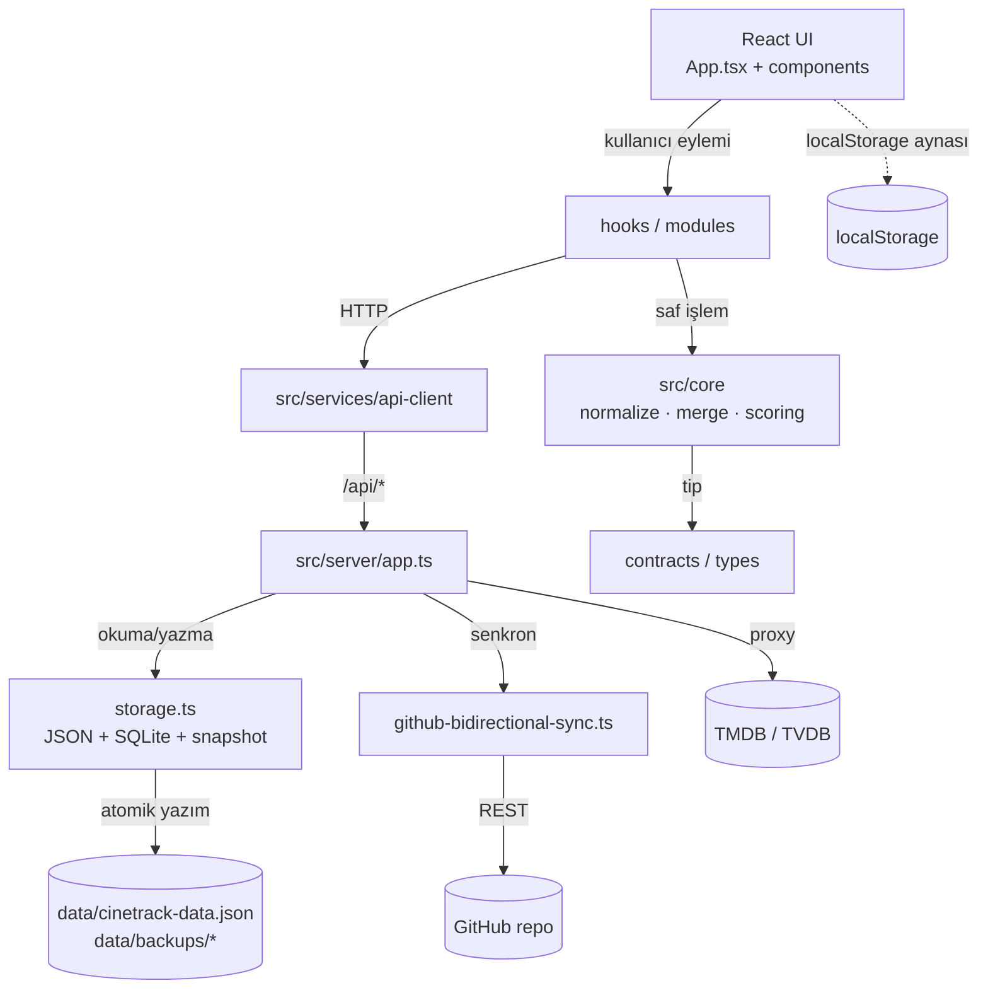
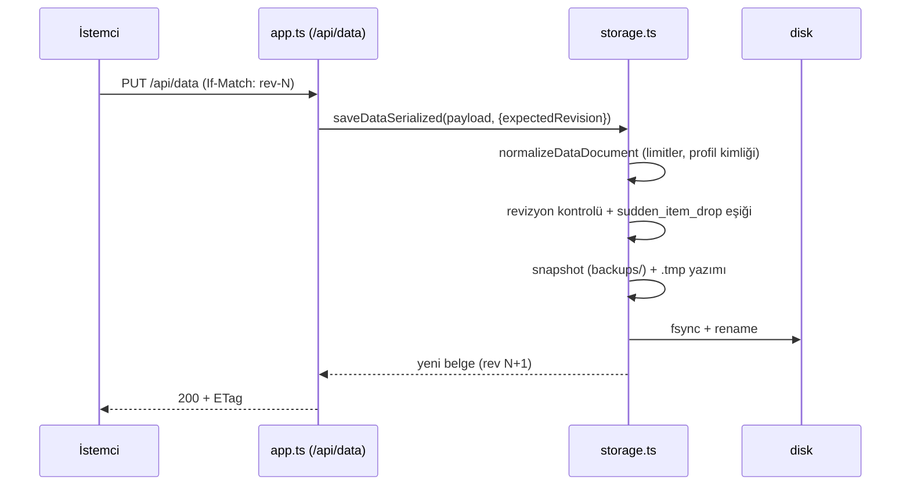
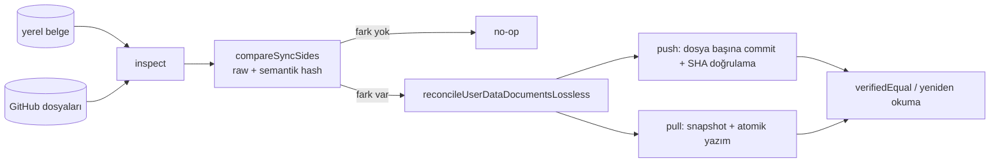
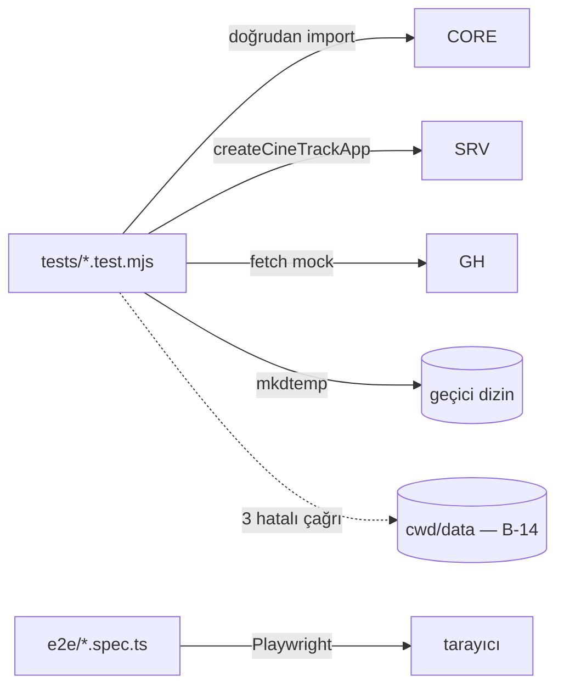

# Aşama 0 — Mimari Harita

> **Taban commit:** `c58ec49aef9e309f5a6e673321db387eaa8a3a75` · **Tarih:** 21 Kasım 2026
> Kaynak: güncel kod okuması + `scripts/maintenance/architecture-rules.json` + `npm run cycles` (0 döngü).

## 1. Giriş noktaları

| Giriş | Dosya | Görev |
|---|---|---|
| Tarayıcı | `index.html` → `src/main.tsx` → `src/App.tsx` | İstemci kabuğu, modül kayıt defteri, profil durumu |
| Sunucu | `server.ts` → `src/server/app.ts` (`createCineTrackApp`) | Express uygulaması, statik servis, API |
| CLI / dev | `tsx server.ts --dev` | Vite middleware ile geliştirme |
| Test | `tsx --test` / Playwright | Entegrasyon ve E2E |

## 2. Katmanlar

| Katman | Dizin | Sorumluluk | Sınır kuralı |
|---|---|---|---|
| Çekirdek | `src/core` | Saf iş mantığı: normalize, merge, skorlama, tarih çözümleme, yedek ayrıştırma | React/Express/Node builtin yasak (5 allowlist ihlali) |
| Sözleşmeler | `src/contracts`, `src/core/*-types.ts` | Tip ve arayüz sözleşmeleri | UI'a bağımlı olamaz |
| Sunucu | `src/server` | Express uçları, kalıcılık, GitHub senkronu, güvenlik | İstemci arayüzüne bağımlı olamaz |
| Orkestrasyon | `src/app` | Profil yedeği, senkron koordinasyonu, modül kaydı | Sunucu uçlarını doğrudan kullanmaz |
| Modüller | `src/modules` | library, content, recommendations, operations, taste-map, relationships, finder | Core'u kullanır, UI'a bağımlı olmaz |
| İstemci servisleri | `src/services` | API istemcisi, taste API, export | Sunucu koduna bağımlı olamaz |
| UI | `src/components`, `src/hooks`, `src/styles` | React bileşenleri, hook'lar, CSS | İş mantığını çekirdekten alır |

## 3. Veri akışı

### 3.1 Yazma yolu (tek serileştirilmiş hat)

### 3.2 Senkron yolu

## 4. Modül haritası

| Modül | Ana dosyalar | Not |
|---|---|---|
| Kütüphane | `modules/library/service.ts`, `operations.ts` | Saf kurallar ↔ I/O ayrımı doğru |
| İçerik | `modules/content/*`, `services/api-client.ts` | TMDB vekili, LRU + in-flight tekilleştirme |
| Öneri | `modules/recommendations/pipeline.ts`, `RecommendationService.ts`, `core/loved-similarity.ts` | Karesel benzerlik darboğazı (B-03) |
| Taste | `core/taste/*` | Deterministik, `now` enjekte edilebilir, 15 sinyal |
| İşlemler | `modules/operations/*` | Görev durumu, retry (B-26 düzeltildi) |
| Zevk Haritası | `modules/taste-map/*`, `core/relationship-explorer.ts` | 90 düğüm / 160 kenar sınırı |
| Keşfet | `modules/discover/state.ts` | Durum sınırı testle korunuyor |
| Yedek | `core/excel/*`, `server/excel-profile-backup.ts`, `app/profile-backup.ts` | Yedek şeması eksik (B-05/B-06) |

## 5. Kritik bağımlılıklar ve riskler

1. **`cinetrack-core.ts` (6.101 satır)** normalize, merge, skorlama, yedek ayrıştırma ve tip tanımlarını birlikte taşıyor. Çekirdeğin en çok çağrılan modülü olması nedeniyle her değişiklik geniş yüzey etkiliyor.
2. **`github-bidirectional-sync.ts` (5.028 satır)** envanter/pull/push/reconcile/verify bloklarını tek dosyada tutuyor; B-10 ve B-39 burada.
3. **`App.tsx` (2.372 satır, 31 `useState`)** profil senkronu, payload üretimi, localStorage aynası ve çakışma kararlarını taşıyor (B-21).
4. **Kopya güvenlik yardımcıları:** `store-types.ts` ↔ `persistent-store-utils.ts` (`redactSecrets`, `stringifyDeterministic`, `hashContent`) — güvenlik kritik fonksiyonun iki kopyası.
5. **`core-purity` ihlalleri (5):** `cinetrack-core.ts` → `idb-keyval`, `services/api-client`; `actor-recommendations.ts` → `api-client`; `relationship-explorer.ts` → `encoding-service`; `taste/migration.ts` → `crypto`. Node'da yalnızca koşullu yükleme sayesinde çalışıyor.

## 6. Test altyapısı (mimari konumu)

## 7. Olumlu mimari tespitler (korunmalı)

- `architecture-boundaries` testi + yalnızca küçülebilen allowlist.
- `runSerialized` / `FileWriteSerializer` ile yazma serileştirme.
- Atomik yazım + `.bak` + 7 snapshot + `restore-journal` + SHA-256.
- `pickContentFields` allowlist'i ile kullanıcı verisinin ortak kataloğa sızmaması.
- Öneri/taste çekirdeğinin React'ten bağımsız, deterministik ve `now` enjekte edilebilir olması.
- 0 bağımlılık döngüsü.
